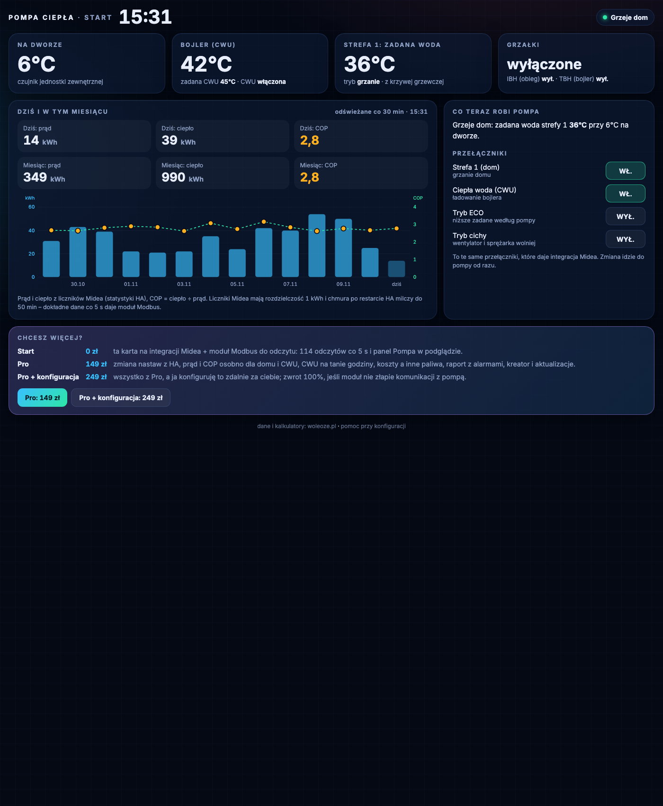
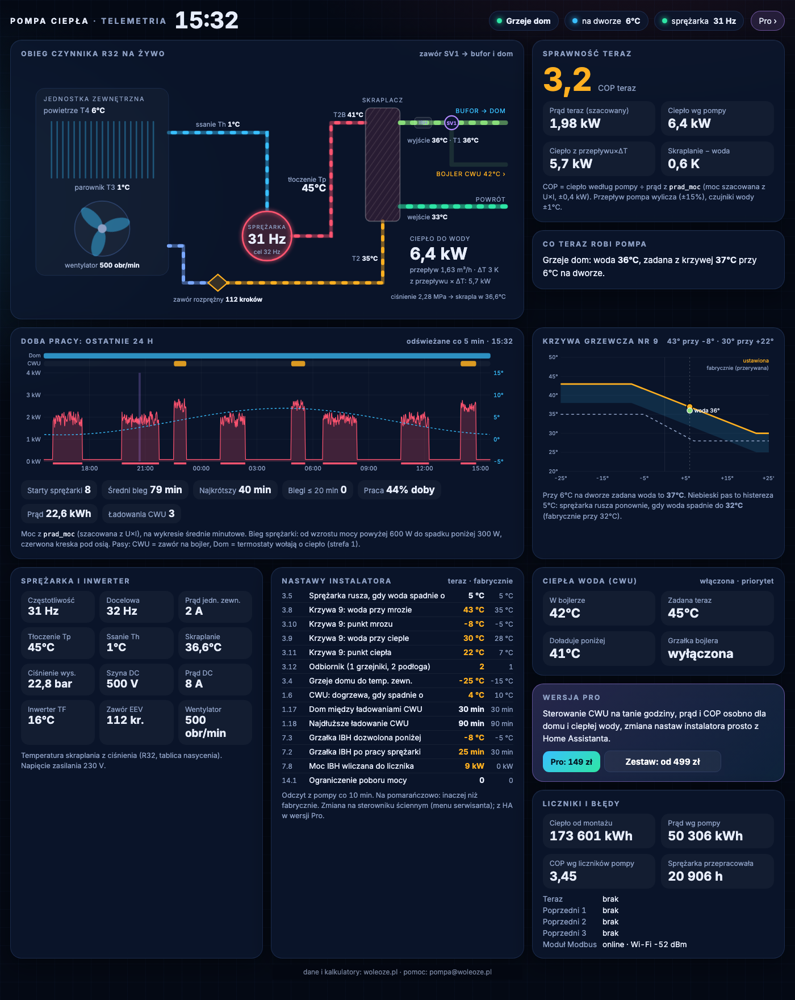
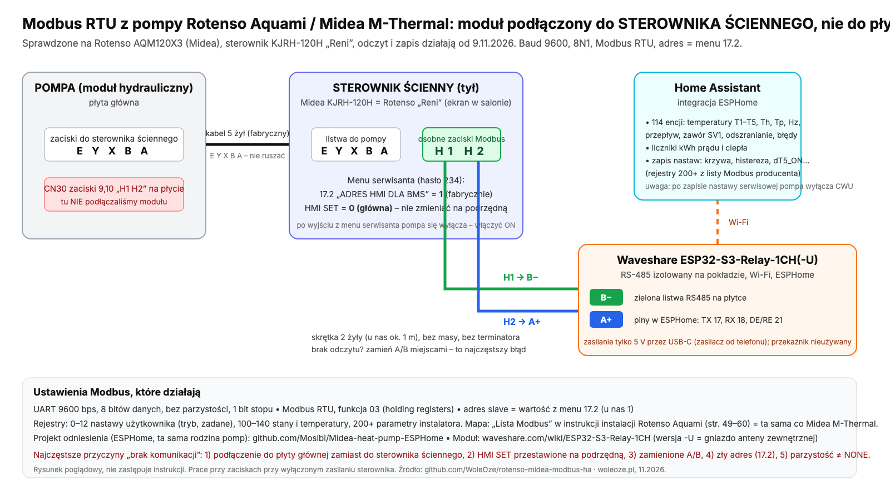

# Rotenso Aquami / Midea M-Thermal w Home Assistant

Podgląd pomp ciepła na płycie **Midea M-Thermal** z czarno-białym sterownikiem (np. **Rotenso Aquami**, **Kaisai Arctic**, **Galmet Prima**) w Home Assistant. Zaczynasz od karty na integracji Midea, bez żadnego sprzętu. Jeśli chcesz zobaczyć więcej, dokładasz moduł ESP32 z RS-485 podpięty do sterownika ściennego: 114 odczytów co 5 s, bez chmury.

Sprawdzone na **Rotenso Aquami AQM120X3** (12 kW, 3 fazy, R32) ze sterownikiem ściennym **KJRH-120H** („Reni”). Działa od 9.11.2026.

[English summary below](#english-summary)


*Karta Start na integracji Midea. Przykładowe dane.*

## Wersje i zestawy

**Start** jest za darmo, działa w pełni i bez limitu czasu. Sprawdzisz na swojej pompie, czy wszystko gada, zanim wydasz złotówkę. Ceny brutto.

| | **Start** | **Pro** | **Zestaw Wi-Fi** | **Zestaw Wi-Fi + LAN** |
|---|---|---|---|---|
| Cena | **0 zł** | **149 zł** | **499 zł** | **549 zł** |
| Karta na integracji Midea, bez dodatkowego sprzętu | ✓ | ✓ | ✓ | ✓ |
| Odczyt pompy przez moduł (114 odczytów co 5 s) | ✓ (wgrywasz sam) | ✓ + zapis | ✓ gotowy | ✓ gotowy |
| Nastawy instalatora z HA (krzywa, histereza, CWU, grzałka) | | ✓ | ✓ | ✓ |
| Prąd i COP osobno: dom i ciepła woda | | ✓ | ✓ | ✓ |
| Koszty, raport, alarmy z progami, harmonogram CWU | | ✓ | ✓ | ✓ |
| Dodatek do HA: instalacja z kluczem, diagnostyka, poprawki | | ✓ | ✓ | ✓ |
| Moduł wgrany i przetestowany, w pudełku | | | moduł ESP32 z RS-485 | bramka RS-485 → LAN i Wi-Fi + zasilacz |
| | [Instalacja niżej](#instalacja-start-w-5-krokach) | [Kupuję Pro →](https://buy.stripe.com/3cIeVd9SIgVa9rS6aL3Je03) | [Zamawiam →](https://buy.stripe.com/cNieVd2qg9sI7jK6aL3Je05) | [Zamawiam →](https://buy.stripe.com/28E00j4yofR633u7eP3Je06) |

Masz własny moduł, ale nie chcesz go wgrywać? **Wgranie i konfiguracja · 299 zł**: wyślij go paczkomatem, odeślę gotowy z licencją Pro, na mój koszt. [Zamawiam wgranie →](https://buy.stripe.com/3cIfZh6Gw0Wc6fGbv53Je07)

Uczciwie: to nie magia. Panel pokazuje, co się dzieje w pompie. Oszczędności zależą od twojej instalacji i nastaw, nie od samego panelu.

## Co jest w tym repo (Start)

| Element | Co robi |
|---|---|
| Karta **Start** (`rotenso-start`, `homeassistant/www/rotenso/start.js`) | działa na integracji **midea_ac_lan**, bez dodatkowego sprzętu. Stan pompy (grzeje dom / ładuje CWU / postój / błąd), temperatura na dworze, bojler i zadana CWU, zadana strefy 1, grzałki IBH/TBH. Prąd i ciepło z liczników Midea dziś i w tym miesiącu, COP, wykres 14 dni. Przełączniki strefy 1, CWU, ECO i trybu cichego (te same, które daje integracja). Sama znajduje pompę. |
| `esphome/pompa-modbus.yaml` | moduł Modbus **tylko do odczytu**: temperatury obiegu (T1–T5, Th, Tp, T2, T2B), częstotliwość sprężarki, przepływ, ciśnienie, zawór SV1, odszranianie, grzałki, kody błędów, liczniki kWh, nastawy użytkownika i instalatora, moc elektryczna szacowana z U×I. Niczego do pompy nie zapisuje. |
| Karta **Pompa** (`rotenso-pompa`, `homeassistant/www/rotenso/pompa.js`) | w trybie podglądu: obieg R32 na żywo, COP teraz, doba pracy (starty sprężarki, pasy CWU/dom/odszranianie), krzywa grzewcza z histerezą, nastawy instalatora a fabryczne, liczniki, błędy. Wszystko klikalne (historia HA). |
| `homeassistant/lovelace/widoki.yaml` | dwa widoki: Start i Pompa. |
| `docs/` | podłączenie krok po kroku ze schematem, FAQ. |


*Panel Pompa (podgląd) na odczytach z naszej instalacji; wykres doby na przykładowych danych.*

## Z jakimi pompami działa

Decyduje sterownik: płyta **Midea M-Thermal** i panel z zaciskami **H1/H2** oraz menu **17.2 „Adres HMI dla BMS”**.

- ✅ **Potwierdzone:** Rotenso Aquami, Midea M-Thermal R32, Kaisai Arctic, Galmet Prima, De Dietrich Modena, York YKF, Immergas Magis M, Mitsui, Vivax/Hyundai, Kosner.
- 🟡 **Prawdopodobne:** Ferroli Omnia 3.2, Clivet EDGE, Airwell Wellea, Baxi/Inventor, Sinclair.
- ❌ **Nie pasuje:** Rotenso Windmi, Heatmi, Airmi, Kospel, Hewalex, Galmet Airmax3, Viessmann Vitocal 100-A.

Pełna lista z modelami i źródłami: [docs/zgodnosc.md](docs/zgodnosc.md) (stan 11.11.2026).

## Instalacja Start w 5 krokach

Karta Start nie wymaga żadnego sprzętu. Wystarczy pompa podłączona do Wi-Fi przez moduł Midea.

1. **Integracja Midea.** Zainstaluj [midea_ac_lan](https://github.com/wuwentao/midea_ac_lan) (HACS) i dodaj pompę. Encje dostaną nazwy typu `sensor.<twoje_id>_outdoor_temperature`, gdzie `<twoje_id>` to numer urządzenia.
2. **Plik karty.** Skopiuj `homeassistant/www/rotenso/start.js` do `/config/www/rotenso/` (katalog `www` utwórz, jeśli go nie ma, i zrestartuj HA).
3. **Zasób.** Ustawienia → Pulpity → ⋮ → Zasoby → „Dodaj zasób”: `/local/rotenso/start.js?v=1`, typ „Moduł JavaScript”.
4. **Widok.** Wklej widok „Start” z `homeassistant/lovelace/widoki.yaml` do pulpitu (Edytuj pulpit → Edytor kodu). Karta sama znajdzie pompę; przy kilku urządzeniach Midea wpisz `urzadzenie: <twoje_id>`.
5. **Sprawdź.** Na karcie powinien być stan pompy i temperatury. Liczniki potrzebują kilku godzin statystyk HA, wykres 14 dni zapełnia się z czasem.

Liczniki Midea mają rozdzielczość 1 kWh, a po restarcie HA dane z chmury Midea potrafią milczeć do 50 min. Dokładne dane co 5 s daje moduł Modbus.

### Potem, jeśli chcesz: moduł Modbus

1. **Sprzęt** (niżej) i podłączenie do H1/H2 sterownika ściennego.
2. **ESPHome.** Skopiuj `esphome/secrets.yaml.example` do `secrets.yaml`, uzupełnij Wi-Fi i klucz API, wgraj `esphome/pompa-modbus.yaml`.
3. **Sterownik ścienny.** Menu serwisanta: `17.2 ADRES HMI DLA BMS` = 1, `HMI SET` = 0 (główna). Po wyjściu z menu pompa się wyłącza, włącz ją z powrotem.
4. **Karta Pompa.** Skopiuj `pompa.js` obok `start.js`, dodaj zasób `/local/rotenso/pompa.js?v=1` i widok „Pompa” z `widoki.yaml`. Sprawdź, czy „Moduł Modbus: online”.

Szczegóły i pułapki: [docs/podlaczenie.md](docs/podlaczenie.md).

## Sprzęt (moduł Modbus)

- **Waveshare ESP32-S3-Relay-1CH** (albo `-U` z gniazdem anteny): ESP32-S3 z izolowanym RS-485 na płytce, ok. 95 zł. Przekaźnik nieużywany. Każdy ESP32 z konwerterem RS-485 też zadziała, trzeba tylko zmienić piny w yaml.
- Zasilanie 5 V przez USB-C.
- Skrętka 2 żyły do zacisków **H1/H2 z tyłu sterownika ściennego**: **H2 → A+, H1 → B−**.



**Najważniejsze:** Modbus obsługuje sterownik ścienny (HMI), nie płyta główna w jednostce. Podłączenie do CN30 na płycie daje brak komunikacji. Pytania: [docs/faq.md](docs/faq.md).

## Skąd prąd i ciepło

- **Karta Start:** z liczników integracji Midea (rozdzielczość 1 kWh). Na dobę wystarczy, na godzinę nie.
- **Moduł Modbus, ciepło:** z czujników pompy (przepływ × ΔT). Przepływ pompa wylicza, nie mierzy, więc licz się z błędem ±15%.
- **Moduł Modbus, prąd:** najlepiej z własnego licznika na zasilaniu pompy. Bez licznika karta używa szacunku z prądu i napięcia jednostki zewnętrznej (`moc_elektryczna_szacowana`, ±0,4 kW). COP z szacunku traktuj orientacyjnie.

## Pro

**Pro kupujesz za 149 zł. Zaraz po płatności dostajesz na e-mail klucz licencji (RPRO-…) i link do paczki plików.** Karty Pro pobierają się z serwera licencji i aktualizują same; serwer dostaje tylko klucz i losowy identyfikator instalacji, żadnych odczytów z pompy. Jeden klucz = jeden dom.

**Instalacja Pro bez kopiowania plików** (Home Assistant OS: Raspberry Pi, Home Assistant Green, mini PC z HA OS):

[](https://my.home-assistant.io/redirect/supervisor_add_addon_repository/?repository_url=https%3A%2F%2Fgithub.com%2FWoleOze%2Frotenso-midea-modbus-ha)

1. Kliknij przycisk wyżej (albo ten z maila) i zainstaluj dodatek **Pompa w HA**.
2. Otwórz panel **Pompa – instalator**, wklej klucz i kliknij **Zainstaluj**.
3. Dodatek sam zapisze pakiety w `packages/pompa_ha/`, dopisze jedną linię `packages:` do `configuration.yaml` (z kopią), sprawdzi konfigurację, doda pulpit **Pompa** i zrestartuje HA.

W panelu jest też **Diagnostyka** (co działa, co poprawić) i **Wyślij raport** do wsparcia. Nikt nie łączy się z twoim HA z zewnątrz. HA w Dockerze: pobierz ZIP z linku w mailu i wgraj pliki ręcznie.

Co dokłada Pro:

- **zmiana nastaw instalatora z Home Assistanta**: zadana CWU, histereza grzania (3.5), dT5_ON (1.6), krzywa grzewcza (3.9), moc grzałki (7.8); moduł ESPHome z zapisem,
- **prąd i COP osobno dla domu i ciepłej wody** (podział po zaworze SV1), dzień / tydzień / miesiąc,
- **harmonogram CWU na tanie godziny** G12w (wyższa zadana w tanich, niższa w drogich, weekendy i święta),
- **panel Koszty**: prąd pompy godzina po godzinie w twojej taryfie obok tego samego ciepła z ekogroszku, węgla, pelletu, drewna, gazu, LPG, oleju i grzałki,
- **panel Raport**: alarmy teraz, dziennik dzień / tydzień / miesiąc, raport dobowy do pliku, powiadomienia na telefon tylko przy prawdziwej anomalii, progi do ustawienia,
- **kreator konfiguracji**: wpisujesz swoje encje (licznik prądu, taryfa, powiadomienia), dostajesz gotowe pliki,
- **aktualizacje kart** same, bez kopiowania plików.

[Kupuję Pro: 149 zł →](https://buy.stripe.com/3cIeVd9SIgVa9rS6aL3Je03)

Płatność kartą lub BLIK przez Stripe. Sprzedawca i operator strony: WOLEOZE.PL Sp. z o.o., ul. Biasowicka 8E, 44-264 Jankowice, NIP 6423246378, KRS 0001048206. Faktura VAT na życzenie: po płatności napisz na pompa@woleoze.pl i podaj NIP.

### Instalacja Pro (klucz)

Po zakupie dostajesz mailem **klucz** w formacie `RPRO-XXXX-XXXX-XXXX-XXXX`. Karty Pro
działają na tym samym pliku `pro.js` (loader), który pobiera i odświeża kartę po kluczu —
nie musisz wgrywać `pompa.js`/`koszty.js`/`raport.js` ręcznie.

1. Skopiuj `homeassistant/www/rotenso/pro.js` z tego repo do swojego HA:
   `/config/www/rotenso/pro.js`.
2. Dodaj zasób: **Ustawienia → Pulpity → ⋮ → Zasoby → Dodaj** →
   URL `/local/rotenso/pro.js`, typ **Moduł JavaScript**. Odśwież stronę (Ctrl+F5).
3. Dodaj kartę (ręczna edycja YAML) i wpisz swój klucz:

   ```yaml
   type: custom:rotenso-pro
   karta: pompa            # pompa | koszty | raport
   klucz: RPRO-XXXX-XXXX-XXXX-XXXX
   # opcjonalnie nadpisania encji (jak w kartach Start):
   encje:
     prad_moc: sensor.moj_licznik_moc
   woleoze: true
   ```

   Dla trzech kart dodaj trzy karty z `karta: pompa`, `karta: koszty`, `karta: raport`
   (ten sam klucz).

4. **Pakiety Pro** (pliki YAML + ESPHome) pobierz jako ZIP z linku z maila
   (`/v1/pakiety?klucz=…`) i rozpakuj do `/config/packages/` (oraz, dla modułu,
   wgraj `esphome/pompa-modbus.yaml` w ESPHome). Po zmianach: **Narzędzia
   programisty → YAML → Sprawdź konfigurację → Zrestartuj**.

Jeden klucz działa na maksymalnie 3 instalacjach. Karta działa też offline (kod
jest pamiętany lokalnie przez 7 dni). Zły lub wycofany klucz pokazuje kafelek z
informacją i linkiem do zakupu.

## Co już dało u nas (dane z HA, 9–11.11.2026)

Te zmiany zrobiliśmy funkcjami wersji Pro (zapis nastaw, harmonogram CWU), a efekt widać w panelach.

- Histereza grzania 2 → 5 K (parametr 3.5): starty sprężarki z 18–23 na 3–7 na dobę, biegi po 1–4 h.
- Harmonogram CWU na tanie godziny + dT5_ON 7 → 4: prąd na CWU z 6,3 na 3,6 kWh/dobę.
- Krzywa grzewcza 34 → 30 °C w ciepłym punkcie: woda zasilania o 1–2 K niżej przy 4–7 °C na dworze. Efekt na rachunku liczony po tygodniu.
- Sezon 11.2025–10.2026: 10 878 kWh prądu, 31 942 kWh ciepła, SCOP 2,94, 64% prądu w taniej strefie. Pompa tańsza od ekogroszku o 9% i od pelletu o 54% przy cenach z listopada 2026.

Liczby z instalacji 12 kW w domu ok. 200 m² z buforem i grzejnikami. U ciebie będzie inaczej, ale karty pokażą ci twoje.

## Bezpieczeństwo

- Wersja Start tylko czyta z pompy. Moduł nie ma żadnej encji do zapisu.
- Przełączniki na karcie Start (strefa 1, CWU, ECO, cichy) to zwykłe przełączniki integracji Midea, działają tak samo jak w aplikacji producenta.
- Nie podawaj zasilania na H1/H2 i nie łącz ich z masą modułu. Moduł zasilaj tylko z 5 V przez USB-C.

## Zanim kupisz pompę

Jeśli trafiłeś tu przed zakupem: ta instalacja działa dobrze, bo ma bufor, dobrze dobraną moc i taryfę dwustrefową. Dobór i montaż robi firma, a różnice między firmami są większe niż między pompami. Lista firm montujących pompy ciepła z opiniami i sprawdzeniem w rejestrach: [woleoze.pl/firmy/pompy-ciepla](https://woleoze.pl/firmy/pompy-ciepla/) (2427 firm, stan 11.11.2026).

## Ograniczenia

- Działa z pompami na płycie Midea M-Thermal z czarno-białym sterownikiem (zaciski H1/H2, menu 17.2), np. Rotenso Aquami, Kaisai Arctic, Galmet Prima; nasza instalacja testowa to Rotenso Aquami AQM120X3. **Nie działa** z Rotenso Windmi, Heatmi, Airmi, Kaisai KHX, Galmet Airmax3 ani Thermatec (inne płyty). Kolorowy sterownik KJRH-120L/L2 ma inne skale rejestrów: wersja w przygotowaniu. Rejestry są z listy Modbus Rotenso (instrukcja instalacji, str. 49–60), wspólnej dla Midea M-Thermal, więc inne modele powinny działać, ale sprawdź listę Modbus w instrukcji swojej pompy.
- Chłodzenie, strefa 2 i solary: rejestry są w yaml, karty ich nie pokazują.
- Przykładowy ekran całego domu (bufor, solary, pompki obiegowe, prąd) jest w `docs/zrzuty/centrum-przyklad.png`. Nie publikujemy go jako gotowca, bo jest szyty pod jedną kotłownię.

## Nie chcesz grzebać w YAML? Weź zestaw

ESPHome, karty i rejestry to wieczór albo dwa dla kogoś, kto robi to pierwszy raz. Zestaw przychodzi gotowy:

- moduł z wgranym programem, przetestowany przed wysyłką, z licencją Pro;
- podpinasz dwie żyły do sterownika ściennego ([instrukcja montażu](https://pompa.woleoze.pl/instrukcja/)), Home Assistant sam wykrywa moduł;
- dodatek „Pompa w HA” po wpisaniu klucza zakłada pakiety, karty i pulpit, a potem sam sprawdza, czy wszystko działa;
- pomoc tylko mailowo, z raportem z panelu. Nikt nie łączy się z twoim Home Assistant.

| | Cena | |
|---|---|---|
| **Zestaw Wi-Fi** (moduł ESP32 z RS-485) | **499 zł** | [Zamawiam →](https://buy.stripe.com/cNieVd2qg9sI7jK6aL3Je05) |
| **Zestaw Wi-Fi + LAN** (bramka RS-485 → LAN i Wi-Fi, zasilacz) | **549 zł** | [Zamawiam →](https://buy.stripe.com/28E00j4yofR633u7eP3Je06) |
| **Wgranie i konfiguracja** twojego modułu (wysyłasz paczkomatem, odsyłam na mój koszt) | **299 zł** | [Zamawiam →](https://buy.stripe.com/3cIfZh6Gw0Wc6fGbv53Je07) |

**To nie dla ciebie, jeśli:** nie masz jeszcze Home Assistant (najpierw postaw HA, np. na Raspberry Pi albo Home Assistant Green) albo twoja pompa nie jest na płycie Midea M-Thermal. Nie wiesz? Wyślij zdjęcie ekranu menu 17.2 na pompa@woleoze.pl, zanim zapłacisz.

Sprzedawca: WOLEOZE.PL Sp. z o.o., ul. Biasowicka 8E, 44-264 Jankowice, NIP 6423246378, KRS 0001048206. Faktura VAT na życzenie: po płatności napisz na pompa@woleoze.pl i podaj NIP.

## Partner technologiczny: woleOZE

Ceny paliw, sprawności kotłów i kalkulatory pochodzą z [woleoze.pl](https://woleoze.pl/pompa-ciepla/).

- Ile kosztuje ogrzewanie pompą u ciebie: [kalkulator pompy ciepła](https://woleoze.pl/kalkulator-pompy-ciepla/).
- Czy G12w się opłaca przy pompie: [kalkulator G11 / G12](https://woleoze.pl/kalkulator-g11-g12/).
- Firma do montażu albo serwisu: [katalog 2427 firm montujących pompy ciepła](https://woleoze.pl/firmy/pompy-ciepla/) (stan 11.11.2026).

**Kontakt w sprawie konfiguracji i Pro:** [pompa@woleoze.pl](mailto:pompa@woleoze.pl)

## Wsparcie

Wersja Start jest darmowa i taka zostanie. Jeśli zaoszczędziła ci godzin grzebania w rejestrach, możesz postawić kawę:

<a href="https://buycoffee.to/woleoze" target="_blank"></a>


## Podziękowania i źródła

- [Mosibi/Midea-heat-pump-ESPHome](https://github.com/Mosibi/Midea-heat-pump-ESPHome): projekt odniesienia dla tej rodziny pomp.
- [wuwentao/midea_ac_lan](https://github.com/wuwentao/midea_ac_lan): integracja Midea, na której działa karta Start.
- Instrukcja instalacji Rotenso Aquami (lista Modbus): dokument producenta, nie kopiujemy go.

Licencja: [Licencja Start](LICENSE) (darmowe użycie w jednym domu, bez odsprzedaży). Wersje opublikowane przed 11.11.2026 15:00 zostają na MIT. Zgłoszenia i inne modele pomp: Issues.

---

## English summary

Home Assistant cards for **Rotenso Aquami / Midea M-Thermal** heat pumps. **Start (free):** a Lovelace card on top of the `midea_ac_lan` integration (no extra hardware: status, temperatures, energy and heat from Midea counters, COP, 14-day chart, zone/DHW/ECO/silent switches), plus a **read-only** ESPHome Modbus RTU config (ESP32-S3 with RS-485, wired to the **wall controller's H1/H2 terminals**, not the main board; 114 readings every 5 s) and a live preview card (refrigerant loop, COP, 24 h run chart, heating curve, installer settings). **Pro (149 PLN, private repo):** writes to installer settings, space heating / DHW split of energy and COP, DHW schedule for cheap tariff hours, cost comparison with other fuels, reports and alarms, setup wizard and updates. Polish UI. Wiring and pitfalls: `docs/podlaczenie.md`. License: "Licencja Start" (free use in one home, no resale); versions published before 11.11.2026 15:00 remain MIT.
