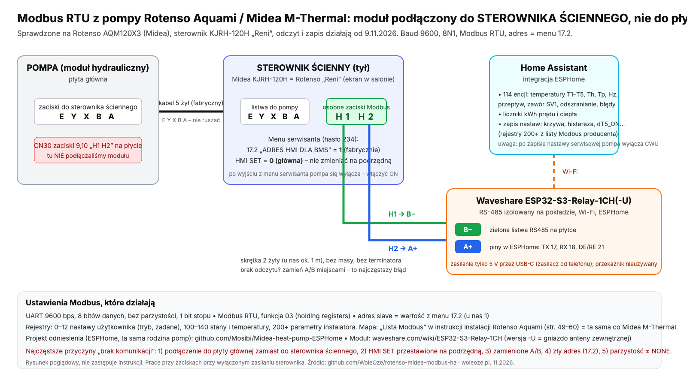

# Podłączenie modułu Modbus do pompy Rotenso Aquami / Midea M‑Thermal

Krok po kroku: od zakupu modułu do pierwszych odczytów w Home Assistancie. Całość to podłączenie dwóch przewodów do sterownika
ściennego i wgranie jednego pliku ESPHome. Nie trzeba otwierać jednostki zewnętrznej ani płyty głównej modułu hydraulicznego.

> Pracujesz przy urządzeniu elektrycznym. Sterownik ścienny zasilany jest niskim napięciem z płyty głównej, ale jednostka wewnętrzna ma 230/400 V.
> Przed zdjęciem obudowy sterownika wyłącz pompę wyłącznikiem (HMI) – nie trzeba odcinać zasilania całego urządzenia, ale jeśli nie masz pewności, odetnij.

## 1. Sprzęt

| element | uwagi |
|---|---|
| **Waveshare ESP32-S3-Relay-1CH** albo **ESP32-S3-Relay-1CH-U** | ESP32-S3 z wbudowanym RS‑485 (zaciski A/B) i jednym przekaźnikiem (nieużywanym). Wersja „-U” ma antenę zewnętrzną – lepsza, gdy sterownik wisi daleko od routera. Piny w kodzie: RS‑485 TX = GPIO17, RX = GPIO18, DE/RE = GPIO21, przekaźnik = GPIO47. |
| zasilanie 5 V (USB‑C) | ładowarka telefonu wystarczy. Nie zasilaj modułu ze sterownika. |
| przewód 2‑żyłowy (skrętka) | np. jedna para z kabla sieciowego. Do kilku metrów długość bez znaczenia; dla dłuższych odcinków użyj skrętki i poprowadź z dala od kabli zasilających. |
| mały śrubokręt płaski | zaciski sprężynowe/śrubowe w sterowniku i w module |

Działa też każdy inny ESP32 z przetwornikiem RS‑485 (np. MAX485) – zmień wtedy piny w sekcji `uart:` i `modbus:` pliku YAML.

## 2. Gdzie się podłączyć: sterownik ścienny, nie płyta główna

Pompa (moduł hydrauliczny) rozmawia ze sterownikiem ściennym (HMI, panel z wyświetlaczem – Midea KJRH‑120H, w Rotenso nazywany „Reni”) po własnej
magistrali. **Wyjście Modbus RTU dla systemów BMS jest na płytce tego sterownika**, na zaciskach oznaczonych **H1** i **H2** (czasem wyprowadzonych
na osobną listwę obok zasilania panelu). Nie podłączaj się do zacisków na płycie głównej jednostki – tam H1/H2 służą do łączenia kilku jednostek w kaskadę, a rejestry Modbus są w sterowniku ściennym.

Podłączenie (wariant potwierdzony w tym repo):

| moduł Waveshare | sterownik ścienny |
|---|---|
| **A+** | **H2** |
| **B−** | **H1** |

Jeśli po uruchomieniu nie ma żadnych odczytów (same `unavailable`, w logu ESPHome „timeout” / „CRC”), **zamień A i B miejscami** – producenci
różnie oznaczają polaryzację RS‑485 i nic się nie zepsuje. Masy (GND) nie łączymy.

## 3. Ustawienia w sterowniku

1. **17.1 HMI SET → GŁÓWNA** (w niektórych wersjach MASTER albo 0; menu serwisowe, pozycja „HMI SET”): sterownik ma pracować jako HMI z adresem 0 – to ustawienie
   fabryczne, sprawdź tylko, czy ktoś go nie zmienił.
2. **Menu 17.2 „ADRES HMI DLA BMS”**: adres Modbus urządzenia, fabrycznie **1**. Taki sam adres jest w YAML (`address: 1` w każdym
   `modbus_controller`). Jeśli masz inny – zmień w YAML, nie w pompie.
3. Parametry łącza są stałe i nie da się ich zmienić: **9600 bodów, 8 bitów danych, bez parzystości, 1 bit stopu (9600 8N1)**.

> ⚠ **Po wyjściu z menu serwisanta pompa się wyłącza.** To normalne zachowanie sterownika: po opuszczeniu menu „DLA SERWISANTA” urządzenie
> przechodzi w stan wyłączony. Włącz je z powrotem przyciskiem zasilania na panelu i sprawdź, czy świeci się tryb grzania i CWU.

## 4. Wgranie ESPHome

1. Skopiuj `esphome/secrets.yaml.example` jako `esphome/secrets.yaml` i wpisz Wi‑Fi, hasło punktu awaryjnego i klucz API
   (generowanie klucza opisane w pliku).
2. Pierwsze wgranie po USB: `esphome run esphome/pompa-modbus.yaml` (albo przez dodatek ESPHome Device Builder w HA – wklej treść pliku, sekrety w jego
   własnym `secrets.yaml`). Kolejne aktualizacje idą po Wi‑Fi (OTA).
3. W Home Assistancie: Ustawienia → Integracje → ESPHome powinien sam znaleźć urządzenie **Pompa Modbus**; podaj klucz API.
4. Po minucie powinny pojawić się encje `sensor.pompa_modbus_*` i `binary_sensor.pompa_modbus_*`. Pierwszy test:
   `sensor.pompa_modbus_t4_temperatura_zewnetrzna` pokazuje sensowną temperaturę, `binary_sensor.pompa_modbus_modul_online` = on.

## 5. Zapisy do pompy

Wersja Start tylko czyta: plik YAML nie ma żadnej encji `number`, więc nic nie trafia do pompy. Zmiana nastaw z Home Assistanta (zadana CWU,
histereza, dT5_ON, krzywa, moc grzałki) jest w wersji [Pro](https://github.com/WoleOze/rotenso-midea-modbus-ha#pro).

## 6. Dalej

- Karty pulpitu: `homeassistant/www/rotenso/` + `homeassistant/lovelace/widoki.yaml` (karta Start działa też bez modułu, na integracji Midea).
- Pytania i problemy: [faq.md](faq.md).
